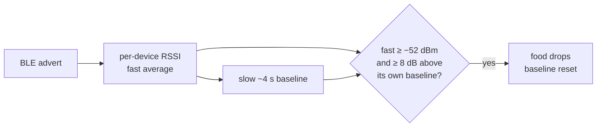

# ESP32 Pocket Aquarium

[](https://github.com/BartosK97/chameleon-pet-esp32/actions/workflows/build.yml)
[](LICENSE)


A pixel-art aquarium on a 2.8" touch display. To feed the fish, you walk up to it with your phone. If nobody comes by for 24 hours, the fish die.

<p align="center"></p>


## What it does

- **Feeding by walking up.** Bring any phone close and food flakes rain down from the surface. No app, no pairing, and any phone can do it.
- **Fish with needs.** Hungry fish chase the flakes and turn pale when they starve. A fish dies after 24 hours without food. Dead fish turn grey, roll belly up and float to the surface.
- **Touch the glass.** A tap sends a ripple across the water and nearby fish dart away. Tap a dead fish to scoop it out. Tap the empty tank to stock five new fish.
- **Remembers everything.** Fish state is saved to flash. After a power cut, the time spent powered off is caught up via NTP, so pulling the plug doesn't help.
- **Real water.** The surface stays level when you tilt the device and sloshes back. Shake it and the sand swirls up and the fish scatter.
- **Day and night.** A tank lamp switches on at 07:00 and off at 22:00 local time; tap the lamp to switch it yourself. At night the tank and backlight dim and the fish sleep near the bottom.
- **Offspring.** A fish that stays well fed for three days gets a baby, which grows to full size over two days.
- **A snail** cleans up flakes that sink to the sand.
- **Visitor counter.** How many people walked up today.
- **Web page** at `http://mini-pet.local/`: live view, feed and lamp buttons, food level, fish count and visitors.
- **Push notifications** via [ntfy](https://ntfy.sh) when the fish get hungry, are starving, die, or have a baby.
- **Live signal graph.** Shows what the Bluetooth sensing sees. Tap the signal icon to hide or show it.
- **Wireless.** Over-the-air updates and a network log, so once it's flashed it only needs power.

## How "walking up" is detected

The ESP32 scans Bluetooth LE adverts. Phones send them constantly, iPhones especially. The firmware does not look at absolute signal strength. It tracks every device on its own:



A laptop lying next to the tank has a strong signal, but its baseline follows it, so it never feeds. A phone that moves closer jumps 10–20 dB above its own baseline and does. In the graph, blue is the strongest device, grey is its baseline, red dots mark the minimum level and a pink column marks each detected approach.

## Hardware

| Part | Notes |
|---|---|
| [Waveshare ESP32-S3-Touch-LCD-2.8B](https://www.waveshare.com/wiki/ESP32-S3-Touch-LCD-2.8B) | ESP32-S3, 16 MB flash, 8 MB PSRAM, 480×640 ST7701 RGB panel, GT911 touch, buzzer, IMU, RTC, LiPo charger |
| USB-C cable | Data-capable, for the first flash |
| USB power supply or 3.7 V LiPo (MX1.25) | Everything after the first flash runs over WiFi |

No wiring and no soldering needed.

## Quick start

```bash
brew install arduino-cli   # or see arduino.github.io/arduino-cli
arduino-cli config add board_manager.additional_urls https://espressif.github.io/arduino-esp32/package_esp32_index.json
arduino-cli core update-index && arduino-cli core install esp32:esp32@4.0.0
```

```bash
cp firmware/mini_pet/secrets.example.h firmware/mini_pet/secrets.h   # your 2.4 GHz WiFi, optional
FQBN=esp32:esp32:esp32s3:FlashSize=16M,PSRAM=opi,PartitionScheme=app3M_fat9M_16MB,CDCOnBoot=cdc
arduino-cli compile -b $FQBN --output-dir build firmware/mini_pet
arduino-cli upload -p /dev/cu.usbmodem101 -b $FQBN firmware/mini_pet
```

### Over the air

Once it's on WiFi, the board shows up as `mini-pet.local`:

```bash
python3 ~/Library/Arduino15/packages/esp32/hardware/esp32/4.0.0/tools/espota.py -i mini-pet.local -f build/mini_pet.ino.bin
nc mini-pet.local 23   # live log: signal, approaches, feedings
```

Without `secrets.h` the firmware runs offline. State is still saved, but without a wall clock, time spent powered off isn't counted and the lamp stays on.

### Push notifications

1. Pick a long random topic name and put it in `secrets.h` as `NTFY_TOPIC`. Anyone who knows the name can read and send to it.
2. Install the ntfy app and subscribe to that topic.
3. The aquarium posts when the fish get hungry (60 %), when they are starving (85 %), when one dies, and when a baby arrives.

Notifications go over plain HTTP. With WiFi and BLE running, this build has no room for the ~40 KB of internal RAM that TLS needs, so the topic name and message travel unencrypted.

## Preview without hardware

All game logic and drawing live in `firmware/mini_pet/pet.cpp`, which has no Arduino dependencies. To render frames on any desktop:

```bash
c++ -std=c++17 -O2 tools/preview.cpp -o preview
./preview | python3 tools/apng.py sheet.png              # five key moments
./preview anim | python3 tools/apng.py anim.png 80        # 8 s animation
```

## Tuning

| Constant | Where | Default |
|---|---|---|
| `APPROACH_MIN`, `APPROACH_RISE` | `pet.h` | −52 dBm, +8 dB |
| `FEED_COOLDOWN` | `pet.cpp` | 8 s |
| `HUNGER_PER_S` | `pet.cpp` | full to dead in 24 h |
| `BREED_FED_S`, `GROW_PER_S` | `pet.cpp` | 3 days well fed, 2 days to grow up |
| `LAMP_ON_MIN`, `LAMP_OFF_MIN`, `TIMEZONE` | `pet.cpp`, `mini_pet.ino` | 07:00, 22:00, Europe/Vienna |
| `SCREEN_GX`, `SCREEN_GY` | `mini_pet.ino` | maps the IMU axes to the screen; flip a sign if the water tilts the wrong way |

## Notes for ESP32-S3 RGB panels

The RGB panel reads its frame buffer out of PSRAM continuously. With WiFi and BLE running, this board glitched until these changes:

- **Draw small, write little.** The game draws a 120×160 canvas in internal RAM. Only canvas pixels that changed are written into the 480×640 frame buffer, each as a 4×4 block; the compare copy sits in PSRAM, because internal RAM is scarce with WiFi and BLE running.
- **Lower pixel clock.** Waveshare's demo uses 30 MHz. 18 MHz still gives about 42 Hz refresh and leaves PSRAM bandwidth for everything else.
- **Write after vsync.** Changes are written right after the panel's vsync, so they stay ahead of the scanline.
- **Bounce buffers** of 20 lines, and `WiFi.persistent(false)` so the WiFi stack never writes to flash.
- **GT911 touch:** hold INT low during reset, or its I2C address comes up as 0x5D or 0x14 at random.
- **Panel ISR on core 0.** The bounce-buffer ISR copies the frame out of PSRAM nonstop and runs on the core that created the panel, so the panel is created on core 0 and the game keeps core 1 to itself.
- **Cheap painting.** The static scene is rendered once and copied each frame. Ellipses take one `sqrt` per row, overlays blend with bit tricks, and the push writes two pixels per 32-bit store. A frame paints in about 5 ms.
- **Paced by vsync.** The frame is pushed right after vsync and the next one is drawn while the panel scans out, giving 43 fps (the panel's refresh rate).
- **Web server on core 0** with a mutex around the game state, so serving the 38 KB live frame never stalls the animation.
- **QMI8658:** the accelerometer only produces data with Waveshare's CTRL7 = 0x43. A read of 0x8000 on every axis means no sample yet.

## Layout

| Path | What |
|---|---|
| `firmware/mini_pet/board.*` | Display, touch, IO expander, buzzer and backlight for the 2.8B |
| `firmware/mini_pet/pet.*` | Aquarium simulation and pixel-art renderer |
| `firmware/mini_pet/mini_pet.ino` | BLE approach detection, IMU, WiFi/OTA/NTP, web server, push, persistence, frame loop |
| `firmware/mini_pet/web_page.h` | The page served at `mini-pet.local` |
| `tools/preview.cpp`, `tools/apng.py` | Desktop renderer for previews and the README animation |

## Ideas

- Sound effects and a little tune when a baby arrives
- More species, plants that grow, a treasure chest that opens when fed often
- Battery mode with deep sleep at night, woken by touch
- Use the spare ESP32-S3 devkit to drive a 64×64 HUB75 LED panel version

## Credits

The ST7701 init sequence, panel timings and pin map come from Waveshare's ESP32-S3-Touch-LCD-2.8B demo. Everything else is original.

## License

[MIT](LICENSE)
