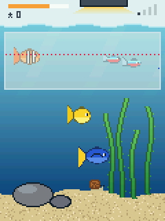
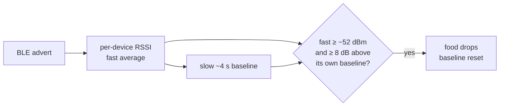

# ESP32 Pocket Aquarium

[](https://github.com/BartosK97/chameleon-pet-esp32/actions/workflows/build.yml)
[](LICENSE)


A pixel-art aquarium on a 2.8" touch display. To feed the fish, you walk up to it with your phone. If nobody comes by for 24 hours, the fish die. And the fish talk back, powered by Claude.

<p align="center"></p>


## What it does

- **Feeding by walking up.** Bring any phone close and food flakes rain down from the surface. No app, no pairing, and any phone can do it.
- **Fish with needs.** Hungry fish chase the flakes and turn pale when they starve. A fish dies after 24 hours without food. Dead fish turn grey, roll belly up and float to the surface.
- **Touch the glass.** A tap sends a ripple across the water and nearby fish dart away. Tap a dead fish to scoop it out. Tap the empty tank to stock five new fish.
- **Remembers everything.** Fish state is saved to flash. After a power cut, the time spent powered off is caught up via NTP, so pulling the plug doesn't help.
- **Real water and sand.** The surface stays level in any pose and sloshes back once. The sand is a grain simulation: tilt the device, turn it on its side or upside down and it slides over grain by grain into the new low corner. The rocks drop, roll and turn onto their flat side, the plants ride on top of the sand and always grow upwards. Shake it and the top layer swirls up and sinks back. A hand's tremor is ignored, so nothing jitters while you hold it.
- **Turn it sideways.** Fish, snail, HUD and speech bubbles turn smoothly to stay upright for you.
- **Sleeps when nobody is around.** After 5 minutes without a touch, a phone or movement the screen fades out. Any of those wakes it; the first touch only wakes it.
- **Day and night.** A tank lamp switches on at 07:00 and off at 22:00 local time; tap the lamp to switch it yourself. At night the tank and backlight dim and the fish sleep near the bottom.
- **Offspring.** A fish that stays well fed for three days gets a baby, which grows to full size over two days.
- **A snail** cleans up flakes that sink to the sand.
- **Talking fish.** Every fish gets a name and a personality from Claude Haiku 5.5, and comments on what happens in speech bubbles: being fed, shaken, turned, tapped, the lights going out, a death or a baby, or nothing at all for a while. They chirp on the buzzer while they talk, except at night. They speak up on their own only every few minutes. Without an API key or internet they fall back to built-in lines.
- **Evening diary.** At 21:00 the fish write a short diary entry of the day and send it as a push notification.
- **Visitor counter.** How many people walked up today.
- **Web page** at `http://mini-pet.local/`: live view, feed, lamp and sound buttons (sound off is remembered), food level, visitors, every fish with name, character and hunger, and a chat box to talk to them (the answer also appears on the device).
- **Push notifications** via [ntfy](https://ntfy.sh) when the fish get hungry, are starving, die, or have a baby; at most one every 30 minutes, and a reboot doesn't repeat a hunger alert.
- **Live signal graph.** Shows what the Bluetooth sensing sees. Tap the signal icon to hide or show it.
- **Wireless.** Over-the-air updates and a network log, so once it's flashed it only needs power.

## How "walking up" is detected

The ESP32 scans Bluetooth LE adverts. Phones send them constantly, iPhones especially. The firmware does not look at absolute signal strength. It tracks every device on its own:



A laptop lying next to the tank has a strong signal, but its baseline follows it, so it never feeds. A phone that moves closer jumps 10–20 dB above its own baseline and does. In the graph, blue is the strongest device, grey is its baseline, red dots mark the minimum level and a pink column marks each detected approach.

## Hardware

| Part | Notes |
|---|---|
| [Waveshare ESP32-S3-Touch-LCD-2.8B](https://www.waveshare.com/wiki/ESP32-S3-Touch-LCD-2.8B) | ESP32-S3, 16 MB flash, 8 MB PSRAM, 480×640 ST7701 RGB panel, GT911 touch, buzzer, IMU, RTC, LiPo charger |
| USB-C cable | Data-capable, for the first flash |
| USB power supply or 3.7 V LiPo (MX1.25) | Everything after the first flash runs over WiFi |

No wiring and no soldering needed.

## Quick start

```bash
brew install arduino-cli   # or see arduino.github.io/arduino-cli
arduino-cli config add board_manager.additional_urls https://espressif.github.io/arduino-esp32/package_esp32_index.json
arduino-cli core update-index && arduino-cli core install esp32:esp32@4.0.0
arduino-cli lib install ArduinoJson
```

```bash
cp firmware/mini_pet/secrets.example.h firmware/mini_pet/secrets.h   # your 2.4 GHz WiFi, optional
FQBN=esp32:esp32:esp32s3:FlashSize=16M,PSRAM=opi,PartitionScheme=app3M_fat9M_16MB,CDCOnBoot=cdc
arduino-cli compile -b $FQBN --output-dir build firmware/mini_pet
arduino-cli upload -p /dev/cu.usbmodem101 -b $FQBN firmware/mini_pet
```

### Over the air

Once it's on WiFi, the board shows up as `mini-pet.local`:

```bash
python3 ~/Library/Arduino15/packages/esp32/hardware/esp32/4.0.0/tools/espota.py -i mini-pet.local -f build/mini_pet.ino.bin
nc mini-pet.local 23   # live log: signal, approaches, feedings
```

Without `secrets.h` the firmware runs offline. State is still saved, but without a wall clock, time spent powered off isn't counted and the lamp stays on.

### Push notifications

1. Pick a long random topic name and put it in `secrets.h` as `NTFY_TOPIC`. Anyone who knows the name can read and send to it.
2. Install the ntfy app and subscribe to that topic.
3. The aquarium posts when the fish get hungry (60 %), when they are starving (85 %), when one dies, when a baby arrives, and its evening diary.

### Talking fish

Put an Anthropic API key in `secrets.h` as `ANTHROPIC_KEY`. The fish use Claude Haiku 5.5, the cheapest current model, with thinking off and short answers. A line costs roughly 300 input and 40 output tokens, about $0.00005 at $0.10 / $0.50 per million tokens. Lines come at most every 20 s and idle chatter every 15–30 min, so a day costs well under a cent. The prompts are too short to cache (Haiku 5.5 caches from 512 tokens) and each is answered once, so caching and batching would only add cost or delay. Each call logs its tokens to the network log, and `/status` reports `ai_calls`, `ai_in` and `ai_out` since boot. Speech, names, the diary and chat answers are in German.

All HTTPS (Claude and ntfy) runs in one task on core 0. TLS needs about 45 KB of internal RAM, which this build only has with Bluetooth off, so that task switches BLE off for the few seconds a call takes and back on afterwards. Certificates are checked against the built-in Mozilla bundle.

## Preview without hardware

All game logic and drawing live in `firmware/mini_pet/pet.cpp`, which has no Arduino dependencies. To render frames on any desktop:

```bash
c++ -std=c++17 -O2 tools/preview.cpp -o preview
./preview | python3 tools/apng.py sheet.png              # five key moments
./preview anim | python3 tools/apng.py anim.png 80        # 8 s animation
```

## Tuning

| Constant | Where | Default |
|---|---|---|
| `APPROACH_MIN`, `APPROACH_RISE` | `pet.h` | −52 dBm, +8 dB |
| `FEED_COOLDOWN` | `pet.cpp` | 8 s |
| `HUNGER_PER_S` | `pet.cpp` | full to dead in 24 h |
| `BREED_FED_S`, `GROW_PER_S` | `pet.cpp` | 3 days well fed, 2 days to grow up |
| `LAMP_ON_MIN`, `LAMP_OFF_MIN`, `TIMEZONE` | `pet.cpp`, `mini_pet.ino` | 07:00, 22:00, Europe/Vienna |
| `SCREEN_GX`, `SCREEN_GY` | `mini_pet.ino` | maps the IMU axes to the screen; flip a sign if the water tilts the wrong way |
| orientation hysteresis | `mini_pet.ino` | another edge must point down clearly for 0.6 s before fish and HUD turn; lying flat keeps the current one |
| `REPOSE`, `SAND_STEPS_PER_S` | `pet.cpp` | sand slides on slopes steeper than ~17°; 60 half-grid steps per second, at most one a frame |
| `SLEEP_MS` | `mini_pet.ino` | screen off after 5 min idle |

## Notes for ESP32-S3 RGB panels

The RGB panel reads its frame buffer out of PSRAM continuously. With WiFi and BLE running, this board glitched until these changes:

- **Draw small, write little.** The game draws a 120×160 canvas in internal RAM. Only canvas pixels that changed are written into the 480×640 frame buffer, each as a 4×4 block; the compare copy sits in PSRAM, because internal RAM is scarce with WiFi and BLE running.
- **Lower pixel clock.** Waveshare's demo uses 30 MHz. 15 MHz gives 36 Hz refresh and leaves PSRAM bandwidth for everything else. 18 MHz (42 Hz) left too little time per frame while the sand flowed, so the frame rate jumped between 42 and 21, which looks worse than a steady 36.
- **Write after vsync.** Changes are written right after the panel's vsync, so they stay ahead of the scanline.
- **Bounce buffers** of 20 lines, and `WiFi.persistent(false)` so the WiFi stack never writes to flash.
- **GT911 touch:** hold INT low during reset, or its I2C address comes up as 0x5D or 0x14 at random.
- **Panel ISR on core 0.** The bounce-buffer ISR copies the frame out of PSRAM nonstop and runs on the core that created the panel, so the panel is created on core 0 and the game keeps core 1 to itself.
- **Cheap painting.** Water is told from air per pixel in fixed point along gravity, with floats only near the surface for the wave. Its shade darkens away from the lamp on the lid, not with depth, so turning the tank repaints only the surface line instead of every water pixel. Fish are drawn straight into the canvas and go through a rotated sprite only during the 0.3 s turn; only the HUD's box turns with them. Ellipses take one `sqrt` per row, overlays blend with bit tricks, and the push writes two pixels per 32-bit store. `pet.cpp` builds at `-O2` instead of Arduino's `-Os`: 1.5x faster painting.
- **Sand in internal RAM.** The grain grid is 2 bits a cell (4.8 KB), so it fits internal RAM; in PSRAM one step took 11 ms once WiFi ran. Each frame moves only every other line, grains read only the neighbours they could fall into, empty stretches are skipped four cells at a time, and the grid sleeps once it has settled.
- **Paced by vsync.** The frame is pushed right after vsync and the next one is drawn while the panel scans out, giving 36 fps (the panel's refresh rate) even while the sand flows.
- **Web server on core 0** with a mutex around the game state, so serving the 38 KB live frame never stalls the animation.
- **QMI8658:** the accelerometer only produces data with Waveshare's CTRL7 = 0x43. A read of 0x8000 on every axis means no sample yet.
- **TLS next to BLE.** With BLE running only ~22 KB of internal RAM is free in one block, and a TLS handshake fails. `BLE.end()` frees about 90 KB, so HTTPS calls run in short BLE pauses.

## Layout

| Path | What |
|---|---|
| `firmware/mini_pet/board.*` | Display, touch, IO expander, buzzer and backlight for the 2.8B |
| `firmware/mini_pet/pet.*` | Aquarium simulation and pixel-art renderer |
| `firmware/mini_pet/mini_pet.ino` | BLE approach detection, IMU, WiFi/OTA/NTP, web server, push, persistence, frame loop |
| `firmware/mini_pet/web_page.h` | The page served at `mini-pet.local` |
| `firmware/mini_pet/ai.*` | HTTPS calls to the Claude Messages API and ntfy |
| `firmware/mini_pet/talk.h` | Types for the fish-talk job queue |
| `firmware/mini_pet/font_tomthumb.h` | 3×5 pixel font with Latin-1 for the speech bubbles |
| `tools/preview.cpp`, `tools/apng.py` | Desktop renderer for previews and the README animation |

## Ideas

- A little tune when a baby arrives
- More species, plants that grow, a treasure chest that opens when fed often
- Battery mode with deep sleep at night, woken by touch
- Use the spare ESP32-S3 devkit to drive a 64×64 HUB75 LED panel version

## Credits

The ST7701 init sequence, panel timings and pin map come from Waveshare's ESP32-S3-Touch-LCD-2.8B demo. The speech-bubble font is Tom Thumb (Brian J. Swetland, Vassilii Khachaturov, Robey Pointer; Adafruit GFX conversion), BSD-3-Clause, license in `font_tomthumb.h`. Everything else is original.

## License

[MIT](LICENSE)
