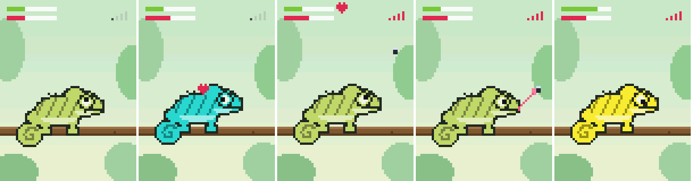

# chameleon-pet-esp32

A pixel-art virtual pet for the Waveshare ESP32-S3 2.8" touch display. It's a chameleon on a branch.



- **Pet it:** tap the chameleon. It runs through the rainbow, a heart floats up, and the joy bar fills.
- **Feed it:** hold any phone right next to the device. The ESP32 scans Bluetooth LE adverts and reads their signal strength. When the strongest one stays above the threshold, a fly buzzes in and the chameleon catches it with its tongue. No app and no pairing needed, and any phone can feed it.
- **Mood colour:** green when fed, fading to olive brown as it gets hungry.
- The turret eye follows taps and the fly, and otherwise looks around. The chameleon blinks now and then.

## Hardware

- Waveshare **ESP32-S3-Touch-LCD-2.8B**: ESP32-S3 with 16 MB flash and 8 MB PSRAM, ST7701 480×640 RGB panel, GT911 touch, TCA9554 IO expander, buzzer, QMI8658 IMU, PCF85063 RTC.
- A USB-C data cable.

## Build and flash

```bash
brew install arduino-cli
arduino-cli config add board_manager.additional_urls https://espressif.github.io/arduino-esp32/package_esp32_index.json
arduino-cli core update-index && arduino-cli core install esp32:esp32
```

```bash
FQBN=esp32:esp32:esp32s3:FlashSize=16M,PSRAM=opi,PartitionScheme=app3M_fat9M_16MB,CDCOnBoot=cdc
arduino-cli compile -b $FQBN firmware/mini_pet
arduino-cli upload -p /dev/cu.usbmodem101 -b $FQBN firmware/mini_pet
```

Tested with arduino-esp32 core 4.0.0. LVGL is not used: the game draws a 60×80 canvas, scales it 8× and writes it into the panel's frame buffer. Only changed blocks are written, because full-frame PSRAM writes plus BLE scanning glitch the RGB panel.

## Preview on a computer

`firmware/mini_pet/pet.cpp` has no Arduino dependencies. `tools/preview.cpp` renders a strip of frames as a PPM:

```bash
c++ -std=c++17 -O2 tools/preview.cpp -o preview && ./preview > preview.ppm
```

## Tuning

The constants are at the top of `firmware/mini_pet/pet.cpp`:

- `NEAR_IN` / `NEAR_OUT`: the RSSI hysteresis in dBm that decides when a phone counts as "next to it".
- `NEAR_DWELL`: how long the signal must stay above `NEAR_IN` before it counts.
- `FEED_COOLDOWN`: minimum time between two feedings.
- `HUNGER_PER_MS`: how fast the chameleon gets hungry.

The serial monitor prints the smoothed RSSI every second, so you can calibrate it for your room.

## Files

| File | What |
|---|---|
| `firmware/mini_pet/board.*` | Display, touch, IO expander, buzzer and backlight for the 2.8B board |
| `firmware/mini_pet/pet.*` | Game state and pixel-art drawing |
| `firmware/mini_pet/mini_pet.ino` | Main loop: BLE scan, touch, frame push |
| `tools/preview.cpp` | Renders frames on a desktop for quick art iteration |

## Credits

The ST7701 init sequence, panel timings and pin map come from Waveshare's ESP32-S3-Touch-LCD-2.8B demo. The rest is original.

## License

MIT, see [LICENSE](LICENSE).
